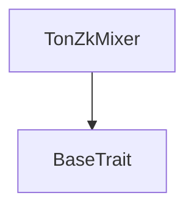
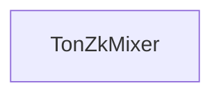

# Tact compilation report
Contract: TonZkMixer
BoC Size: 6142 bytes

## Structures (Structs and Messages)
Total structures: 23

### DataSize
TL-B: `_ cells:int257 bits:int257 refs:int257 = DataSize`
Signature: `DataSize{cells:int257,bits:int257,refs:int257}`

### SignedBundle
TL-B: `_ signature:fixed_bytes64 signedData:remainder<slice> = SignedBundle`
Signature: `SignedBundle{signature:fixed_bytes64,signedData:remainder<slice>}`

### StateInit
TL-B: `_ code:^cell data:^cell = StateInit`
Signature: `StateInit{code:^cell,data:^cell}`

### Context
TL-B: `_ bounceable:bool sender:address value:int257 raw:^slice = Context`
Signature: `Context{bounceable:bool,sender:address,value:int257,raw:^slice}`

### SendParameters
TL-B: `_ mode:int257 body:Maybe ^cell code:Maybe ^cell data:Maybe ^cell value:int257 to:address bounce:bool = SendParameters`
Signature: `SendParameters{mode:int257,body:Maybe ^cell,code:Maybe ^cell,data:Maybe ^cell,value:int257,to:address,bounce:bool}`

### MessageParameters
TL-B: `_ mode:int257 body:Maybe ^cell value:int257 to:address bounce:bool = MessageParameters`
Signature: `MessageParameters{mode:int257,body:Maybe ^cell,value:int257,to:address,bounce:bool}`

### DeployParameters
TL-B: `_ mode:int257 body:Maybe ^cell value:int257 bounce:bool init:StateInit{code:^cell,data:^cell} = DeployParameters`
Signature: `DeployParameters{mode:int257,body:Maybe ^cell,value:int257,bounce:bool,init:StateInit{code:^cell,data:^cell}}`

### StdAddress
TL-B: `_ workchain:int8 address:uint256 = StdAddress`
Signature: `StdAddress{workchain:int8,address:uint256}`

### VarAddress
TL-B: `_ workchain:int32 address:^slice = VarAddress`
Signature: `VarAddress{workchain:int32,address:^slice}`

### BasechainAddress
TL-B: `_ hash:Maybe int257 = BasechainAddress`
Signature: `BasechainAddress{hash:Maybe int257}`

### DepositTon
TL-B: `deposit_ton#00001001 commitment:uint256 = DepositTon`
Signature: `DepositTon{commitment:uint256}`

### Withdraw
TL-B: `withdraw#00001002 piA:^cell piB:^cell piC:^cell root:uint256 nullifierHash:uint256 recipient:address assetId:uint256 = Withdraw`
Signature: `Withdraw{piA:^cell,piB:^cell,piC:^cell,root:uint256,nullifierHash:uint256,recipient:address,assetId:uint256}`

### SetPaused
TL-B: `set_paused#00001003 paused:bool = SetPaused`
Signature: `SetPaused{paused:bool}`

### EmergencyRescue
TL-B: `emergency_rescue#00001004 recipient:address amount:coins jettonWallet:address = EmergencyRescue`
Signature: `EmergencyRescue{recipient:address,amount:coins,jettonWallet:address}`

### UpgradeCode
TL-B: `upgrade_code#00001005 new_code:^cell = UpgradeCode`
Signature: `UpgradeCode{new_code:^cell}`

### SetPool
TL-B: `set_pool#00001006 assetId:uint256 denomination:coins active:bool = SetPool`
Signature: `SetPool{assetId:uint256,denomination:coins,active:bool}`

### ClaimFees
TL-B: `claim_fees#00001007 amount:coins destination:address = ClaimFees`
Signature: `ClaimFees{amount:coins,destination:address}`

### SetFeeRouting
TL-B: `set_fee_routing#00001008 autoRoute:bool = SetFeeRouting`
Signature: `SetFeeRouting{autoRoute:bool}`

### JettonNotification
TL-B: `jetton_notification#7362d09c query_id:uint64 amount:coins sender:address forward_payload:remainder<slice> = JettonNotification`
Signature: `JettonNotification{query_id:uint64,amount:coins,sender:address,forward_payload:remainder<slice>}`

### JettonTransfer
TL-B: `jetton_transfer#0f8a7ea5 query_id:uint64 amount:coins destination:address response_destination:address custom_payload:Maybe ^cell forward_ton_amount:coins forward_payload:remainder<slice> = JettonTransfer`
Signature: `JettonTransfer{query_id:uint64,amount:coins,destination:address,response_destination:address,custom_payload:Maybe ^cell,forward_ton_amount:coins,forward_payload:remainder<slice>}`

### DepositEvent
TL-B: `deposit_event#53c98244 assetId:uint256 commitment:uint256 leafIndex:uint32 newRoot:uint256 = DepositEvent`
Signature: `DepositEvent{assetId:uint256,commitment:uint256,leafIndex:uint32,newRoot:uint256}`

### WithdrawalEvent
TL-B: `withdrawal_event#37ee08e5 assetId:uint256 nullifierHash:uint256 recipient:address amount:coins fee:coins = WithdrawalEvent`
Signature: `WithdrawalEvent{assetId:uint256,nullifierHash:uint256,recipient:address,amount:coins,fee:coins}`

### TonZkMixer$Data
TL-B: `_ owner:address paused:bool tonDenomination:coins poolDenominations:dict<uint256, coins> poolActive:dict<uint256, bool> assetToWallet:dict<uint256, address> nextIndex:uint32 currentRoot:uint256 filledSubtrees:dict<uint8, uint256> roots:dict<uint256, bool> nullifiers:dict<uint256, bool> totalDeposits:uint32 totalWithdrawals:uint32 accumulatedFees:coins autoFeeRouting:bool = TonZkMixer`
Signature: `TonZkMixer{owner:address,paused:bool,tonDenomination:coins,poolDenominations:dict<uint256, coins>,poolActive:dict<uint256, bool>,assetToWallet:dict<uint256, address>,nextIndex:uint32,currentRoot:uint256,filledSubtrees:dict<uint8, uint256>,roots:dict<uint256, bool>,nullifiers:dict<uint256, bool>,totalDeposits:uint32,totalWithdrawals:uint32,accumulatedFees:coins,autoFeeRouting:bool}`

## Get methods
Total get methods: 15

## isKnownRoot
Argument: root

## isNullifierSpent
Argument: nullifierHash

## currentRoot
No arguments

## nextIndex
No arguments

## isPaused
No arguments

## owner
No arguments

## totalDeposits
No arguments

## totalWithdrawals
No arguments

## poolDenomination
Argument: assetId

## protocolFeePercent
No arguments

## adminFeeWallet
No arguments

## accumulatedFees
No arguments

## upfrontFee
Argument: denomination

## userTvl
No arguments

## autoFeeRouting
No arguments

## Exit codes
* 2: Stack underflow
* 3: Stack overflow
* 4: Integer overflow
* 5: Integer out of expected range
* 6: Invalid opcode
* 7: Type check error
* 8: Cell overflow
* 9: Cell underflow
* 10: Dictionary error
* 11: 'Unknown' error
* 12: Fatal error
* 13: Out of gas error
* 14: Virtualization error
* 32: Action list is invalid
* 33: Action list is too long
* 34: Action is invalid or not supported
* 35: Invalid source address in outbound message
* 36: Invalid destination address in outbound message
* 37: Not enough Toncoin
* 38: Not enough extra currencies
* 39: Outbound message does not fit into a cell after rewriting
* 40: Cannot process a message
* 41: Library reference is null
* 42: Library change action error
* 43: Exceeded maximum number of cells in the library or the maximum depth of the Merkle tree
* 50: Account state size exceeded limits
* 128: Null reference exception
* 129: Invalid serialization prefix
* 130: Invalid incoming message
* 131: Constraints error
* 132: Access denied
* 133: Contract stopped
* 134: Invalid argument
* 135: Code of a contract was not found
* 136: Invalid standard address
* 138: Not a basechain address

## Trait inheritance diagram

## Contract dependency diagram

